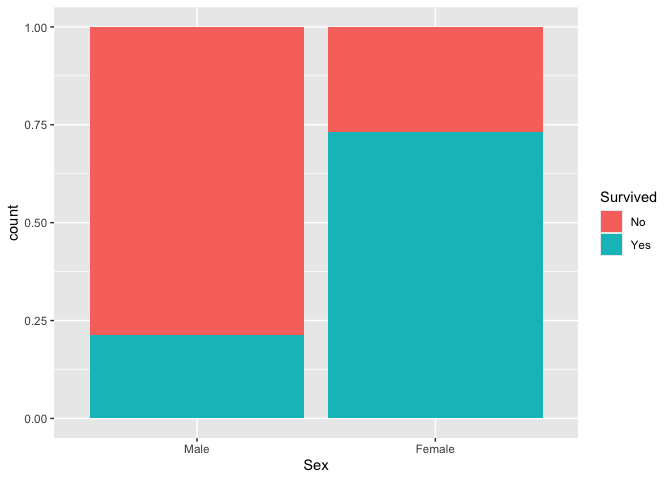

<!-- README.md is generated from README.Rmd. Please edit that file -->

# The flipbookr package

<!-- badges: start -->

<!-- badges: end -->

“Flipbooks” present side-by-side, aligned, incremental code-output
evolution via automated code parsing and reconstruction. Like physical
flipbooks, they let the ‘reader’ watch a scene evolve at their own pace.
Flipbooks seek to reduce the guesswork involved between code and its
behavior by presenting substeps of a coding pipeline; the reader of a
flipbook observes the partial code that is used to create “A.1”, “A.2”,
“A.3” etc. all the way up to “B”.

Here’s the ‘minimal flipbook’ template that’s available with the
package:

[View flipbook in a new
tab](https://evamaerey.github.io/flipbookr/minimal_flipbook.html)


The create a flipbook isn’t hard because parsing and reconstruction of
code pipelines into substeps is automated\!

flipbookr’s `chunk_reveal()` disassembles a single code chunk and
creates the “build” of multiple partial-code chunks on different slides
(the — is automatically generated for you too).

Check out the details on how to do this in this [*doublecrocheted*
version of the same
flipbook](https://evamaerey.github.io/flipbookr/minimal_flipbook_double_crochet.html)
(quotes the .Rmd source on some slides).

## Installation

You can install the development version of flipbookr with devtools as
follows:

``` r
devtools::install_github("EvaMaeRey/flipbookr")
```

You will most likely use this package with the rmarkdown presentation
tool, Xaringan, which is available on CRAN:

``` r
install.packages("xaringan")
```

## Template

The package includes several templates for building a flipbook that
demonstrates various flipbooking modes.

The templates can be accessed from within RStudio. For example: New File
-\> RMarkdown -\> From Template -\> A Minimal Flipbook. The templates
are:

  - A Minimal Flipbook
  - Most Flipbookr Features, [preview
    output](https://raw.githubusercontent.com/EvaMaeRey/flipbookr/master/inst/rmarkdown/templates/minimal-flipbook/skeleton/skeleton.Rmd)
  - A Python Flipbook

## How it works:

[Here’s](https://evamaerey.github.io/flipbooks/flipbookr/flipbookr_building_blocks#1)
a flipbook going through some of the internal flipbookr functions.

``` r
library(tidyverse)
#> ── Attaching core tidyverse packages ──────────────────────── tidyverse 2.0.0 ──
#> ✔ dplyr     1.1.4     ✔ readr     2.1.5
#> ✔ forcats   1.0.0     ✔ stringr   1.5.1
#> ✔ ggplot2   3.5.1     ✔ tibble    3.2.1
#> ✔ lubridate 1.9.3     ✔ tidyr     1.3.1
#> ✔ purrr     1.0.2     
#> ── Conflicts ────────────────────────────────────────── tidyverse_conflicts() ──
#> ✖ dplyr::filter() masks stats::filter()
#> ✖ dplyr::lag()    masks stats::lag()
#> ℹ Use the conflicted package (<http://conflicted.r-lib.org/>) to force all conflicts to become errors
Titanic %>% 
  data.frame() %>% 
  uncount(Freq) %>% 
  ggplot() + 
  aes(x = Sex) + 
  geom_bar(position = "fill") + 
  aes(fill = Survived)
```



## Coming soon

``` r
chunk_reveal_live(chunk_name = "sample_chunk")
```

# how am I using rstudioapi wrong?

``` r
download.file(url = "https://evamaerey.github.io/flipbookr/", destfile = "myhtml.html")
rstudioapi::viewer("myhtml.html")
```

``` r
list.files("R/")
#>  [1] "0_knitr_live_experimental.R" "a_create_test_code.R"       
#>  [3] "b_parsing.R"                 "c_prep_sequences.R"         
#>  [5] "d_prep_rmd_chunks.R"         "e_define_css.R"             
#>  [7] "f_chunk_expand.R"            "g_exported_functions.R"     
#>  [9] "h_write_instant_flipbook.R"  "mini.R"                     
#> [11] "utils-pipe.R"
```

``` r
# Emi Tanaka (@statsgen) and Garrick Aden-Buie (@grrrck) and Evangeline Reynolds (@EvaMaeRey)
# have contributed to this code

# how to solve "no visible binding for global variable" note
utils::globalVariables(

c('func', '.', 'raw_code', 'non_seq', 'func', '.','raw_code', '.',
  'replacements','line','code','highlight','connector','line','func',
  '.','raw_code','open_par','closed_par', 'auto','connector','line1',
  'text','open_square','line','token','open_par','closed_par','open_curly',
  'closed_curly','closed_square','full_line','num_open_par','num_closed_par',
  'num_open_curly','num_closed_curly','num_open_square','num_closed_square',
  'balanced_paren','balanced_curly','balanced_square','all_parenteses_balanced',
  'raw_code', 'connector','all_parentheses_balanced', 'line', 'auto', 'user',
  'non_seq', 'rotate','raw_code', '.')

)
#>  [1] "func"                     "."                       
#>  [3] "raw_code"                 "non_seq"                 
#>  [5] "replacements"             "line"                    
#>  [7] "code"                     "highlight"               
#>  [9] "connector"                "open_par"                
#> [11] "closed_par"               "auto"                    
#> [13] "line1"                    "text"                    
#> [15] "open_square"              "token"                   
#> [17] "open_curly"               "closed_curly"            
#> [19] "closed_square"            "full_line"               
#> [21] "num_open_par"             "num_closed_par"          
#> [23] "num_open_curly"           "num_closed_curly"        
#> [25] "num_open_square"          "num_closed_square"       
#> [27] "balanced_paren"           "balanced_curly"          
#> [29] "balanced_square"          "all_parenteses_balanced" 
#> [31] "all_parentheses_balanced" "user"                    
#> [33] "rotate"


####### Make some test code available as character strings #####
create_code <- function(){ # for testing w/o knitting

  "cars %>%             # the data  #BREAK
  filter(speed > 4) %>%  # subset
  ggplot() +              # pipe to ggplot
  aes(x = speed) +
  aes(y = dist) +
  # Describing what follows
  geom_point(alpha = .3) + #BREAK
  geom_point(alpha = 1) + #BREAK2
  geom_jitter(alpha = .5) + #BREAK3
  aes(color =
  speed > 14
  ) %+%
  cars ->
  my_plot  #BREAK

  NULL #OMIT

  1 + 1 #BREAK"

}


create_code_remove <- function(){

"ggplot(data = cars) +
  aes(x = speed) +
  aes(y = dist) + #BREAK-2
  geom_rug()"

}


create_code_rotate_omit <- function(){

  'ggplot(data = cars) +
  aes(x = speed) +
  aes(y = dist) +
  geom_point(size = 8,
             shape = 21,
             alpha = .9,
             color = "snow") +
  aes(fill = speed) +
  scale_fill_viridis_c(option = "magma") + #OMIT
  scale_fill_viridis_c(option = "magma") + #ROTATE
  scale_fill_viridis_c(option = "cividis") + #ROTATE
  scale_fill_viridis_c(option = "plasma") + #ROTATE
  NULL'

}


create_injectable_code <- function(){

  "for (i in 1:10){
  print(i)
}  "

}


create_rotate_code <- function(){ # for testing w/o knitting

  "cars %>%             # the data  #BREAK
  filter(speed > 4) %>%  # subset
  ggplot() +              # pipe to ggplot
  aes(x = speed) +
  aes(y = dist) +
  # Describing what follows
  geom_point(alpha = .3) + #ROTATE
  geom_point(color = 'blue') + #ROTATE
  geom_point(shape = 'square') -> #ROTATE
  my_plot  #BREAK


  1 + 1 #BREAK"

}


create_short_code <- function(){ # for testing w/o knitting

  "cars %>%             # the data
  filter(speed > 4) %>%  # subset #BREAK
  ggplot() #BREAK"

}

#' Title
#'
#' @export
#'
#' @examples
#' create_base_pipe_code()
#'
#' create_base_pipe_code() %>%
#'  code_parse()
create_base_pipe_code <- function(){ # for testing w/o knitting

  "cars |>             # the data
  filter(speed > 4) |>
  ggplot() #BREAK"

}


create_single_line_code <- function(){ # for testing no reveal

  "cars"

}


create_ggplot_code <- function(){ # for testing w/o knitting

  "ggplot2::ggplot(data = cars) +  # initiate ggplot
  ggplot2::aes(x = speed) +
  ggplot2::aes(y = dist) +
  # Describing what follows
  ggplot2::geom_point(alpha = .3) "

}


create_python_code <- function(){

  "xobject = load_iris()
xobject = pd.DataFrame(xobject.data,
columns=xobject.feature_names)
def evenOdd( x ):
    if (x % 2 == 0):
        print \"even\"
    else:
        print \"odd\"

# Driver code
evenOdd(2)
xobject.pipe(remove_units).pipe(length_times_width)"

}


create_sql_code <- function(){

  "SELECT *
  FROM tbl_hello_world
  WHERE "

}


create_python_code_pipeline <- function(){

  "student_scores \\\n  .melt(id_vars=['student', \"sex\"], \n        var_name=\"subject\", \n        value_name=\"final_grade\") \\\n  .sort_values(by=['final_grade'], ascending=False) \\\n  .head(3)"

}


create_data_table_code <- function(){ # for testing w/o knitting

  'gapminder::gapminder %>%
  data.table() %>%
   .[year > 1980] %>%
   .[                       ,
     mean(gdpPercap)        ,
     by = .(continent, year) ]'

}

create_left_assign_code <- function(){

  # for testing w/o knitting
  "my_cars <- cars %>%             # the data  #BREAK
filter(speed > 4) %>%  # subset
ggplot() +              # pipe to ggplot
aes(x = speed) +
aes(y = dist) +
# Describing what follows
geom_point(alpha = .3)"

}
```
